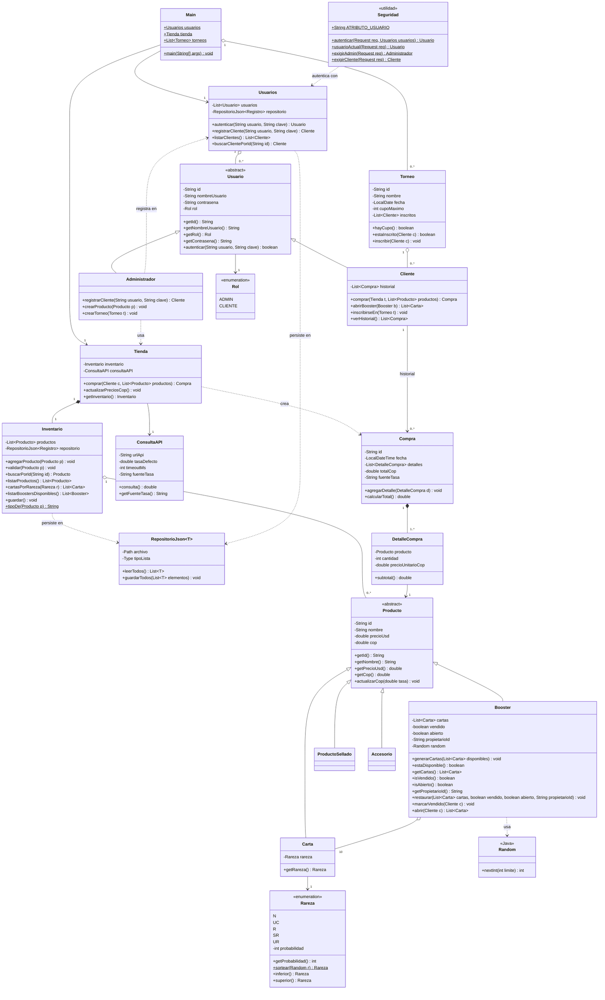

# Cards4Play – Diagrama de clases (v3)

Proyecto final de Desarrollo · Backend de una tienda de cartas coleccionables (TCG) con torneos, en Java.

Esta versión parte del rediseño (v2) y lo pone al día con el código que ya existe en el repositorio: **21 clases**, con visibilidad, tipos, atributos, métodos y relaciones con su cardinalidad. La imagen equivalente está en `docs/diagrama_clases_cards4play_v3.png`.

**Leyenda de visibilidad:** `+` público · `-` privado · los miembros estáticos se marcan como _(estático)_.

---

## 1. Visión general

Las clases se agrupan en seis bloques:

| Bloque | Clases | Qué resuelve |
|---|---|---|
| Coordinación | `Main`, `Tienda`, `Inventario`, `ConsultaAPI`, `Usuarios`, `RepositorioJson` | Quién contiene qué, quién coordina el sistema, la persistencia en JSON y la tasa de cambio USD→COP |
| Seguridad | `Seguridad` | Autenticación HTTP Basic y permisos por rol |
| Usuarios | `Usuario`, `Administrador`, `Cliente`, `Rol` | Usuarios y roles ADMIN / CLIENTE |
| Productos | `Producto`, `Carta`, `Booster`, `ProductoSellado`, `Accesorio`, `Rareza` | Inventario vendible y generación de boosters |
| Compras y torneos | `Compra`, `DetalleCompra`, `Torneo` | Recibo con varias líneas e inscripción a torneos |
| Externa | `Random` | Clase de Java (`java.util`) usada para el sorteo |

**Clases nuevas respecto a la v2:** `Usuarios`, `RepositorioJson`, `Seguridad`.

---

## 2. Diagrama

**Cómo leer las flechas:**

| Símbolo | Significado |
|---|---|
| `<\|--` | Herencia (la clase de la derecha hereda de la de la izquierda) |
| `-->` | Asociación (la clase de origen conoce a la de destino) |
| `o--` | Agregación (el "todo" contiene "partes" que pueden existir sin él) |
| `*--` | Composición (las partes dependen de la vida del "todo") |
| `..>` | Dependencia (la clase de origen usa a la de destino) |

---

## 3. Descripción de las clases

### 3.1 Coordinación

#### `Main`

Punto de entrada. Crea los servicios, registra la autenticación y las rutas de cada área y define el formato de los errores. Sus atributos son estáticos para que las rutas lleguen a la tienda y a los usuarios.

| Tipo | Miembro | Retorno |
|---|---|---|
| Atributo (estático) | `+ usuarios: Usuarios` | |
| Atributo (estático) | `+ tienda: Tienda` | |
| Atributo (estático) | `+ torneos: List<Torneo>` | |
| Método (estático) | `+ main(args: String[])` | `void` |

#### `Tienda`

Coordina el sistema: contiene el inventario y usa la consulta a la API para los precios en COP.

| Tipo | Miembro | Retorno |
|---|---|---|
| Atributo | `- inventario: Inventario` | |
| Atributo | `- consultaAPI: ConsultaAPI` | |
| Método | `+ comprar(c: Cliente, productos: List<Producto>)` | `Compra` |
| Método | `+ actualizarPreciosCop()` | `void` |
| Método | `+ getInventario()` | `Inventario` |

#### `Inventario`

Guarda y administra los productos. Los persiste en un archivo JSON a través de un registro plano (cada producto con su tipo) para no perder la herencia.

| Tipo | Miembro | Retorno |
|---|---|---|
| Atributo | `- productos: List<Producto>` | |
| Atributo | `- repositorio: RepositorioJson<Registro>` | |
| Método | `+ agregarProducto(p: Producto)` | `void` |
| Método | `+ validar(p: Producto)` | `void` |
| Método | `+ buscarPorId(id: String)` | `Producto` |
| Método | `+ listarProductos()` | `List<Producto>` |
| Método | `+ cartasPorRareza(r: Rareza)` | `List<Carta>` |
| Método | `+ listarBoostersDisponibles()` | `List<Booster>` |
| Método | `+ guardar()` | `void` |
| Método (estático) | `+ tipoDe(p: Producto)` | `String` |

#### `ConsultaAPI`

Consulta la tasa de cambio USD→COP. Si la API falla o no responde a tiempo, usa la tasa por defecto.

| Tipo | Miembro | Retorno |
|---|---|---|
| Atributo | `- urlApi: String` | |
| Atributo | `- tasaDefecto: double` | |
| Atributo | `- timeoutMs: int` | |
| Atributo | `- fuenteTasa: String` | |
| Método | `+ consulta()` | `double` |
| Método | `+ getFuenteTasa()` | `String` |

#### `Usuarios` (**nueva en v3**)

Guarda y busca a los usuarios (administrador y clientes) en usuarios.json. Crea el administrador por defecto si no existe y valida los datos y los duplicados al registrar clientes.

| Tipo | Miembro | Retorno |
|---|---|---|
| Atributo | `- usuarios: List<Usuario>` | |
| Atributo | `- repositorio: RepositorioJson<Registro>` | |
| Método | `+ autenticar(usuario: String, clave: String)` | `Usuario` |
| Método | `+ registrarCliente(usuario: String, clave: String)` | `Cliente` |
| Método | `+ listarClientes()` | `List<Cliente>` |
| Método | `+ buscarClientePorId(id: String)` | `Cliente` |

#### `RepositorioJson<T>` (**nueva en v3**)

Lee y escribe una lista de objetos en un archivo JSON dentro de la carpeta DATA_DIR. Es la base de toda la persistencia.

| Tipo | Miembro | Retorno |
|---|---|---|
| Atributo | `- archivo: Path` | |
| Atributo | `- tipoLista: Type` | |
| Método | `+ leerTodos()` | `List<T>` |
| Método | `+ guardarTodos(elementos: List<T>)` | `void` |

### 3.2 Seguridad

#### `Seguridad` (utilidad, métodos estáticos, **nueva en v3**)

Autenticación HTTP Basic y permisos por rol. Main la ejecuta antes de cada petición (menos /salud) y las rutas piden el usuario actual o exigen administrador o cliente.

| Tipo | Miembro | Retorno |
|---|---|---|
| Atributo (estático) | `+ ATRIBUTO_USUARIO: String` | |
| Método (estático) | `+ autenticar(req: Request, usuarios: Usuarios)` | `Usuario` |
| Método (estático) | `+ usuarioActual(req: Request)` | `Usuario` |
| Método (estático) | `+ exigirAdmin(req: Request)` | `Administrador` |
| Método (estático) | `+ exigirCliente(req: Request)` | `Cliente` |

### 3.3 Usuarios

#### `Usuario` (abstracta)

Datos comunes de quien usa el sistema.

| Tipo | Miembro | Retorno |
|---|---|---|
| Atributo | `- id: String` | |
| Atributo | `- nombreUsuario: String` | |
| Atributo | `- contrasena: String` | |
| Atributo | `- rol: Rol` | |
| Método | `+ getId()` | `String` |
| Método | `+ getNombreUsuario()` | `String` |
| Método | `+ getRol()` | `Rol` |
| Método | `+ getContrasena()` | `String` |
| Método | `+ autenticar(usuario: String, clave: String)` | `boolean` |

#### `Administrador` (hereda de `Usuario`)

Único que registra clientes y crea productos y torneos. La creación de productos está unificada en un solo método.

| Tipo | Miembro | Retorno |
|---|---|---|
| Método | `+ registrarCliente(usuario: String, clave: String)` | `Cliente` |
| Método | `+ crearProducto(p: Producto)` | `void` |
| Método | `+ crearTorneo(t: Torneo)` | `void` |

#### `Cliente` (hereda de `Usuario`)

Compra productos, abre sus boosters y se inscribe en torneos.

| Tipo | Miembro | Retorno |
|---|---|---|
| Atributo | `- historial: List<Compra>` | |
| Método | `+ comprar(t: Tienda, productos: List<Producto>)` | `Compra` |
| Método | `+ abrirBooster(b: Booster)` | `List<Carta>` |
| Método | `+ inscribirseEn(t: Torneo)` | `void` |
| Método | `+ verHistorial()` | `List<Compra>` |

#### `Rol` (enumeración)

Rol de un usuario.

Valores: `ADMIN`, `CLIENTE`.

### 3.4 Productos

#### `Producto` (abstracta)

Datos comunes de todo lo que se vende. El precio en COP (cop) se llena con la tasa de cambio.

| Tipo | Miembro | Retorno |
|---|---|---|
| Atributo | `- id: String` | |
| Atributo | `- nombre: String` | |
| Atributo | `- precioUsd: double` | |
| Atributo | `- cop: double` | |
| Método | `+ getId()` | `String` |
| Método | `+ getNombre()` | `String` |
| Método | `+ getPrecioUsd()` | `double` |
| Método | `+ getCop()` | `double` |
| Método | `+ actualizarCop(tasa: double)` | `void` |

#### `Carta` (hereda de `Producto`)

Carta coleccionable con su rareza.

| Tipo | Miembro | Retorno |
|---|---|---|
| Atributo | `- rareza: Rareza` | |
| Método | `+ getRareza()` | `Rareza` |

#### `Booster` (hereda de `Producto`)

Sobre con exactamente 10 cartas. Se vende una sola vez y se abre una sola vez; su contenido está oculto hasta que el dueño lo abre. Los métodos restaurar y los getters permiten guardarlo y recuperarlo desde el JSON.

| Tipo | Miembro | Retorno |
|---|---|---|
| Atributo | `- cartas: List<Carta>` | |
| Atributo | `- vendido: boolean` | |
| Atributo | `- abierto: boolean` | |
| Atributo | `- propietarioId: String` | |
| Atributo | `- random: Random` | |
| Método | `+ generarCartas(disponibles: List<Carta>)` | `void` |
| Método | `+ estaDisponible()` | `boolean` |
| Método | `+ getCartas()` | `List<Carta>` |
| Método | `+ isVendido()` | `boolean` |
| Método | `+ isAbierto()` | `boolean` |
| Método | `+ getPropietarioId()` | `String` |
| Método | `+ restaurar(cartas: List<Carta>, vendido: boolean, abierto: boolean, propietarioId: String)` | `void` |
| Método | `+ marcarVendido(c: Cliente)` | `void` |
| Método | `+ abrir(c: Cliente)` | `List<Carta>` |

#### `ProductoSellado` (hereda de `Producto`)

Producto sellado. Sin atributos ni métodos propios.

Sin atributos ni métodos propios.

#### `Accesorio` (hereda de `Producto`)

Accesorio. Sin atributos ni métodos propios.

Sin atributos ni métodos propios.

#### `Rareza` (enumeración)

Rarezas de las cartas. Las probabilidades del enunciado (N 50 %, UC 25 %, R 15 %, SR 7 %, UR 3 %) viven solo aquí.

Valores: `N`, `UC`, `R`, `SR`, `UR`.

| Tipo | Miembro | Retorno |
|---|---|---|
| Atributo | `- probabilidad: int` | |
| Método | `+ getProbabilidad()` | `int` |
| Método (estático) | `+ sortear(r: Random)` | `Rareza` |
| Método | `+ inferior()` | `Rareza` |
| Método | `+ superior()` | `Rareza` |

### 3.5 Compras y torneos

#### `Compra`

Recibo con una o más líneas de detalle.

| Tipo | Miembro | Retorno |
|---|---|---|
| Atributo | `- id: String` | |
| Atributo | `- fecha: LocalDateTime` | |
| Atributo | `- detalles: List<DetalleCompra>` | |
| Atributo | `- totalCop: double` | |
| Atributo | `- fuenteTasa: String` | |
| Método | `+ agregarDetalle(d: DetalleCompra)` | `void` |
| Método | `+ calcularTotal()` | `double` |

#### `DetalleCompra`

Ítem del recibo de una compra.

| Tipo | Miembro | Retorno |
|---|---|---|
| Atributo | `- producto: Producto` | |
| Atributo | `- cantidad: int` | |
| Atributo | `- precioUnitarioCop: double` | |
| Método | `+ subtotal()` | `double` |

#### `Torneo`

Torneo con cupo máximo; no admite más inscritos que el cupo ni inscribir dos veces al mismo cliente.

| Tipo | Miembro | Retorno |
|---|---|---|
| Atributo | `- id: String` | |
| Atributo | `- nombre: String` | |
| Atributo | `- fecha: LocalDate` | |
| Atributo | `- cupoMaximo: int` | |
| Atributo | `- inscritos: List<Cliente>` | |
| Método | `+ hayCupo()` | `boolean` |
| Método | `+ estaInscrito(c: Cliente)` | `boolean` |
| Método | `+ inscribir(c: Cliente)` | `void` |

### 3.6 Externa

#### `Random` (clase de Java)

Clase de Java (java.util) usada para el sorteo de cartas.

| Tipo | Miembro | Retorno |
|---|---|---|
| Método | `+ nextInt(limite: int)` | `int` |

---

## 4. Relaciones entre clases

### Herencia

| Clase hija | Clase padre |
|---|---|
| `Administrador` | `Usuario` |
| `Cliente` | `Usuario` |
| `Carta` | `Producto` |
| `Booster` | `Producto` |
| `ProductoSellado` | `Producto` |
| `Accesorio` | `Producto` |

### Asociación, agregación, composición y dependencia

| Origen | Tipo | Destino | Cardinalidad (origen – destino) | Significado |
|---|---|---|---|---|
| `Main` | Asociación | `Usuarios` | – 1 | Main usa el servicio de usuarios |
| `Main` | Asociación | `Tienda` | – 1 | Main usa la tienda |
| `Main` | Agregación | `Torneo` | 1 – 0..* | Lista de torneos |
| `Tienda` | Composición | `Inventario` | 1 – 1 | La tienda contiene su inventario |
| `Tienda` | Asociación | `ConsultaAPI` | – 1 | Consulta la tasa de cambio |
| `Tienda` | Dependencia | `Compra` | – | Crea las compras |
| `Inventario` | Agregación | `Producto` | 1 – 0..* | Contiene los productos |
| `Inventario` | Dependencia | `RepositorioJson` | – | Guarda los productos en JSON |
| `Usuarios` | Agregación | `Usuario` | 1 – 0..* | Contiene a todos los usuarios |
| `Usuarios` | Dependencia | `RepositorioJson` | – | Guarda los usuarios en JSON |
| `Seguridad` | Dependencia | `Usuarios` | – | Valida usuario y clave contra los usuarios guardados |
| `Administrador` | Dependencia | `Usuarios` | – | Registra clientes en el servicio de usuarios |
| `Administrador` | Dependencia | `Tienda` | – | Crea productos en el inventario de la tienda |
| `Cliente` | Asociación | `Compra` | 1 – 0..* | Historial del cliente |
| `Compra` | Composición | `DetalleCompra` | 1 – 1..* | Líneas del recibo |
| `DetalleCompra` | Asociación | `Producto` | – 1 | Producto de la línea |
| `Usuario` | Asociación | `Rol` | – 1 | Rol del usuario |
| `Carta` | Asociación | `Rareza` | – 1 | Rareza de la carta |
| `Booster` | Agregación | `Carta` | 1 – 10 | Las 10 cartas del booster |
| `Booster` | Dependencia | `Random` | – | Sorteo de cartas |
| `Torneo` | Agregación | `Cliente` | 1 – 0..* | Clientes inscritos |

**Nota:** `Rareza.sortear(r: Random)` recibe un `Random` como parámetro. Esa dependencia no se dibuja para no sobrecargar el diagrama.

---

## 5. Clases de apoyo que no se dibujan

Estas clases existen en el código pero no forman parte del modelo del negocio:

| Clase | Paquete | Para qué sirve |
|---|---|---|
| `ApiException` | `util` | Error con código HTTP (400, 401, 403, 404, 409). Cualquier capa la lanza y `Main` la convierte en `{"error": "..."}` |
| `Cuerpo` | `api` | Lee el cuerpo JSON de una petición (400 si está vacío o mal formado) |
| `Json` | `util` | Gson compartido, con soporte de fechas (`LocalDate` y `LocalDateTime`) |
| `Config` | `util` | Lee las variables de entorno `PORT`, `DATA_DIR`, `TASA_DEFECTO`, `ADMIN_USUARIO` y `ADMIN_CLAVE` |
| `Errores` | `api` | Arma el JSON de error con el formato único de la API |
| `RutasUsuarios`, `RutasProductos`, `RutasCompras`, `RutasTorneos` | `api` | Registran los endpoints de cada área |

---

## 6. Qué cambió frente a la v2

| Cambio | Por qué |
|---|---|
| Nueva clase `Usuarios` | La lista de clientes ya no vive en `Main`: un servicio guarda y busca usuarios, crea el administrador por defecto y valida los duplicados |
| Nueva clase `RepositorioJson<T>` | Base de la persistencia en JSON, usada por `Usuarios` e `Inventario` |
| Nueva clase `Seguridad` | Autenticación HTTP Basic y permisos por rol (401 y 403) |
| `Main`: atributos estáticos `usuarios`, `tienda` y `torneos` (ya no `clientes`) | Las rutas necesitan llegar a los servicios |
| `Inventario`: `validar`, `guardar`, `tipoDe` y `repositorio` | Persistencia de productos con un registro plano que conserva el tipo |
| `Booster`: getters y `restaurar` | Poder guardar el booster en el JSON y recuperarlo |
| `Usuario`: `getContrasena` | Solo para persistir; nunca se devuelve en una respuesta |
| `Administrador`: `registrarCliente` usa `Usuarios` y `crearProducto` usa la `Tienda` | El administrador pasa por los servicios en vez de tocar los datos |
| `Rareza.sortear` es estático | No necesita una instancia de la enumeración |
| Se quita `Main o-- Cliente` | Los clientes los contiene `Usuarios` |

---

## 7. Estado de implementación

| Área | Hecho | Pendiente |
|---|---|---|
| Usuarios y seguridad | Autenticación Basic, permisos por rol, administrador por defecto, `GET /yo`, `POST` y `GET /clientes`, persistencia en `usuarios.json` | Docker y despliegue |
| Productos | Inventario con persistencia, validaciones, `POST /productos`, `GET /productos` y `GET /productos/{id}` (rama `feature/inventario-productos`) | `Rareza.sortear`, `Booster.generarCartas`, `marcarVendido`, `abrir` y los endpoints de boosters |
| Compras, torneos y tasa | – | `ConsultaAPI`, `Tienda.comprar` y `actualizarPreciosCop`, `Compra` y `DetalleCompra`, `Torneo` y los endpoints de compras, torneos y tasa |

---

## 8. Supuestos pendientes de confirmar

- **"Sistema de cuentas":** se interpretó como que el sistema registra los usuarios y lo que cada cliente compra (`Usuarios` y `Cliente.historial`). Si el profesor se refería a algo más, como saldo o cuenta por cliente, faltaría una clase para eso.
- **"Instanciado" en la cadena `Producto → Instanciado → API` de los apuntes:** se modeló como la clase `ConsultaAPI`, que la `Tienda` usa para llenar el atributo `cop`.
- **Segundo "Booster" en la lista del administrador:** se tomó como un error de escritura.
- **Contraseñas en texto plano** en `usuarios.json`: suficiente para el proyecto; lo correcto sería guardarlas cifradas.
- **Persistencia de torneos y compras:** falta decidir el formato del registro plano (como en `Usuarios` e `Inventario`), a cargo de quien implemente esa parte.
