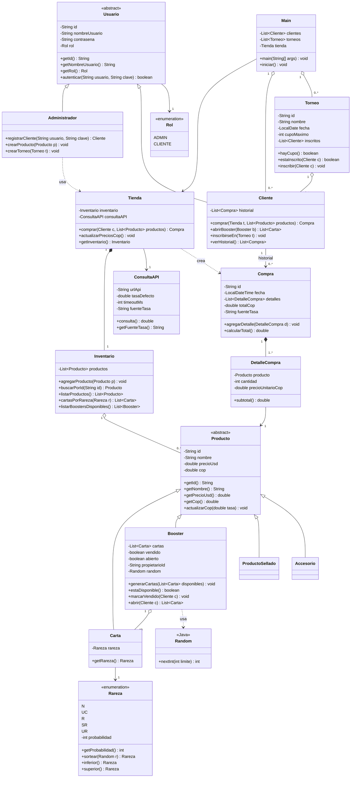

# Cards4Play – Diagrama de clases (rediseño)

Proyecto final de Desarrollo · Backend de una tienda de cartas coleccionables (TCG) con torneos, en Java.

Este documento recrea el diagrama `diagrama_clases_cards4play_v2.png` con el mismo contenido: **18 clases**, con visibilidad, tipos, atributos, métodos y relaciones con su cardinalidad.

**Leyenda de visibilidad:** `+` público · `-` privado

---

## 1. Visión general

Las clases se agrupan en cinco bloques:

| Bloque | Clases | Qué resuelve |
|---|---|---|
| Coordinación | `Main`, `Tienda`, `Inventario`, `ConsultaAPI` | Quién contiene qué, quién coordina el sistema y cómo entra la tasa de cambio USD→COP |
| Usuarios | `Usuario`, `Administrador`, `Cliente`, `Rol` | Autenticación y roles ADMIN / CLIENTE |
| Productos | `Producto`, `Carta`, `Booster`, `ProductoSellado`, `Accesorio`, `Rareza` | Inventario vendible y generación de boosters |
| Compras y torneos | `Compra`, `DetalleCompra`, `Torneo` | Recibo con varias líneas e inscripción a torneos |
| Externa | `Random` | Clase de Java (`java.util`) usada para el sorteo |

**Clases nuevas respecto a la primera versión:** `Main`, `Tienda`, `Inventario`, `ConsultaAPI` y `DetalleCompra`.

---

## 2. Diagrama

**Cómo leer las flechas:**

| Símbolo | Significado |
|---|---|
| `<\|--` | Herencia (la clase de la derecha hereda de la de la izquierda) |
| `-->` | Asociación (la clase de origen conoce a la de destino) |
| `o--` | Agregación (el "todo" contiene "partes" que pueden existir sin él) |
| `*--` | Composición (las partes dependen de la vida del "todo") |
| `..>` | Dependencia (la clase de origen usa a la de destino) |

---

## 3. Descripción de las clases

### 3.1 Coordinación

#### `Main`
Punto de entrada. Guarda las listas de clientes y torneos y arranca la tienda.

| Tipo | Miembro | Retorno |
|---|---|---|
| Atributo | `- clientes: List<Cliente>` | |
| Atributo | `- torneos: List<Torneo>` | |
| Atributo | `- tienda: Tienda` | |
| Método | `+ main(args: String[])` | `void` |
| Método | `+ iniciar()` | `void` |

#### `Tienda`
Coordina el sistema: contiene el inventario, registra las compras y actualiza los precios en COP con la clase de consulta a la API.

| Tipo | Miembro | Retorno |
|---|---|---|
| Atributo | `- inventario: Inventario` | |
| Atributo | `- consultaAPI: ConsultaAPI` | |
| Método | `+ comprar(c: Cliente, productos: List<Producto>)` | `Compra` |
| Método | `+ actualizarPreciosCop()` | `void` |
| Método | `+ getInventario()` | `Inventario` |

#### `Inventario`
Guarda y administra los productos.

| Tipo | Miembro | Retorno |
|---|---|---|
| Atributo | `- productos: List<Producto>` | |
| Método | `+ agregarProducto(p: Producto)` | `void` |
| Método | `+ buscarPorId(id: String)` | `Producto` |
| Método | `+ listarProductos()` | `List<Producto>` |
| Método | `+ cartasPorRareza(r: Rareza)` | `List<Carta>` |
| Método | `+ listarBoostersDisponibles()` | `List<Booster>` |

#### `ConsultaAPI`
Consulta la tasa de cambio USD→COP. Si la API falla o no responde a tiempo, usa la tasa por defecto.

| Tipo | Miembro | Retorno |
|---|---|---|
| Atributo | `- urlApi: String` | |
| Atributo | `- tasaDefecto: double` | |
| Atributo | `- timeoutMs: int` | |
| Atributo | `- fuenteTasa: String` | |
| Método | `+ consulta()` | `double` |
| Método | `+ getFuenteTasa()` | `String` |

### 3.2 Usuarios

#### `Usuario` (abstracta)

| Tipo | Miembro | Retorno |
|---|---|---|
| Atributo | `- id: String` | |
| Atributo | `- nombreUsuario: String` | |
| Atributo | `- contrasena: String` | |
| Atributo | `- rol: Rol` | |
| Método | `+ getId()` | `String` |
| Método | `+ getNombreUsuario()` | `String` |
| Método | `+ getRol()` | `Rol` |
| Método | `+ autenticar(usuario: String, clave: String)` | `boolean` |

#### `Administrador` (hereda de `Usuario`)
Sin atributos propios. Su creación está **unificada**: un solo método para cualquier tipo de producto y otro para torneos.

| Tipo | Miembro | Retorno |
|---|---|---|
| Método | `+ registrarCliente(usuario: String, clave: String)` | `Cliente` |
| Método | `+ crearProducto(p: Producto)` | `void` |
| Método | `+ crearTorneo(t: Torneo)` | `void` |

#### `Cliente` (hereda de `Usuario`)

| Tipo | Miembro | Retorno |
|---|---|---|
| Atributo | `- historial: List<Compra>` | |
| Método | `+ comprar(t: Tienda, productos: List<Producto>)` | `Compra` |
| Método | `+ abrirBooster(b: Booster)` | `List<Carta>` |
| Método | `+ inscribirseEn(t: Torneo)` | `void` |
| Método | `+ verHistorial()` | `List<Compra>` |

#### `Rol` (enumeración)
Valores: `ADMIN`, `CLIENTE`.

### 3.3 Productos

#### `Producto` (abstracta)

| Tipo | Miembro | Retorno |
|---|---|---|
| Atributo | `- id: String` | |
| Atributo | `- nombre: String` | |
| Atributo | `- precioUsd: double` | |
| Atributo | `- cop: double` | |
| Método | `+ getId()` | `String` |
| Método | `+ getNombre()` | `String` |
| Método | `+ getPrecioUsd()` | `double` |
| Método | `+ getCop()` | `double` |
| Método | `+ actualizarCop(tasa: double)` | `void` |

#### `Carta` (hereda de `Producto`)

| Tipo | Miembro | Retorno |
|---|---|---|
| Atributo | `- rareza: Rareza` | |
| Método | `+ getRareza()` | `Rareza` |

#### `Booster` (hereda de `Producto`)
Contiene exactamente 10 cartas. Se vende una sola vez y se abre una sola vez; su contenido está oculto hasta que el dueño lo abre. Usa `Random` para generar su contenido.

| Tipo | Miembro | Retorno |
|---|---|---|
| Atributo | `- cartas: List<Carta>` (exactamente 10) | |
| Atributo | `- vendido: boolean` | |
| Atributo | `- abierto: boolean` | |
| Atributo | `- propietarioId: String` | |
| Atributo | `- random: Random` | |
| Método | `+ generarCartas(disponibles: List<Carta>)` | `void` |
| Método | `+ estaDisponible()` | `boolean` |
| Método | `+ marcarVendido(c: Cliente)` | `void` |
| Método | `+ abrir(c: Cliente)` | `List<Carta>` |

#### `ProductoSellado` y `Accesorio` (heredan de `Producto`)
Sin atributos ni métodos adicionales.

#### `Rareza` (enumeración)
Valores: `N`, `UC`, `R`, `SR`, `UR`.

| Tipo | Miembro | Retorno |
|---|---|---|
| Atributo | `- probabilidad: int` | |
| Método | `+ getProbabilidad()` | `int` |
| Método | `+ sortear(r: Random)` | `Rareza` |
| Método | `+ inferior()` | `Rareza` |
| Método | `+ superior()` | `Rareza` |

Probabilidades del enunciado: N 50 %, UC 25 %, R 15 %, SR 7 %, UR 3 %. `inferior()` y `superior()` sirven para la regla de respaldo cuando no hay cartas de la rareza sorteada.

### 3.4 Compras y torneos

#### `Compra`
Es un recibo con una o más líneas de detalle.

| Tipo | Miembro | Retorno |
|---|---|---|
| Atributo | `- id: String` | |
| Atributo | `- fecha: LocalDateTime` | |
| Atributo | `- detalles: List<DetalleCompra>` | |
| Atributo | `- totalCop: double` | |
| Atributo | `- fuenteTasa: String` (`"API"` o `"DEFECTO"`) | |
| Método | `+ agregarDetalle(d: DetalleCompra)` | `void` |
| Método | `+ calcularTotal()` | `double` |

#### `DetalleCompra` (ítem del recibo)

| Tipo | Miembro | Retorno |
|---|---|---|
| Atributo | `- producto: Producto` | |
| Atributo | `- cantidad: int` | |
| Atributo | `- precioUnitarioCop: double` | |
| Método | `+ subtotal()` | `double` |

#### `Torneo`

| Tipo | Miembro | Retorno |
|---|---|---|
| Atributo | `- id: String` | |
| Atributo | `- nombre: String` | |
| Atributo | `- fecha: LocalDate` | |
| Atributo | `- cupoMaximo: int` | |
| Atributo | `- inscritos: List<Cliente>` | |
| Método | `+ hayCupo()` | `boolean` |
| Método | `+ estaInscrito(c: Cliente)` | `boolean` |
| Método | `+ inscribir(c: Cliente)` | `void` |

### 3.5 Externa

#### `Random` (`java.util`)

| Tipo | Miembro | Retorno |
|---|---|---|
| Método | `+ nextInt(limite: int)` | `int` |

---

## 4. Relaciones entre clases

### Herencia

| Clase hija | Clase padre |
|---|---|
| `Administrador` | `Usuario` |
| `Cliente` | `Usuario` |
| `Carta` | `Producto` |
| `Booster` | `Producto` |
| `ProductoSellado` | `Producto` |
| `Accesorio` | `Producto` |

### Asociación, agregación, composición y dependencia

| Origen | Tipo | Destino | Cardinalidad (origen – destino) | Significado |
|---|---|---|---|---|
| `Main` | Asociación | `Tienda` | – 1 | `Main` usa una tienda |
| `Main` | Agregación | `Cliente` | 1 – 0..* | Lista de clientes |
| `Main` | Agregación | `Torneo` | 1 – 0..* | Lista de torneos |
| `Tienda` | Composición | `Inventario` | 1 – 1 | La tienda contiene su inventario |
| `Tienda` | Asociación | `ConsultaAPI` | – 1 | Consulta la tasa de cambio |
| `Tienda` | Dependencia | `Compra` | – | Crea las compras |
| `Inventario` | Agregación | `Producto` | 1 – 0..* | Contiene los productos |
| `Cliente` | Asociación | `Compra` | 1 – 0..* | Historial del cliente |
| `Compra` | Composición | `DetalleCompra` | 1 – 1..* | Líneas del recibo |
| `DetalleCompra` | Asociación | `Producto` | – 1 | Producto de la línea |
| `Administrador` | Dependencia | `Tienda` | – | Usa la tienda para llegar al inventario |
| `Usuario` | Asociación | `Rol` | – 1 | Rol del usuario |
| `Carta` | Asociación | `Rareza` | – 1 | Rareza de la carta |
| `Booster` | Agregación | `Carta` | 1 – 10 | Las 10 cartas del booster |
| `Booster` | Dependencia | `Random` | – | Sorteo de cartas |
| `Torneo` | Agregación | `Cliente` | 1 – 0..* | Clientes inscritos |
